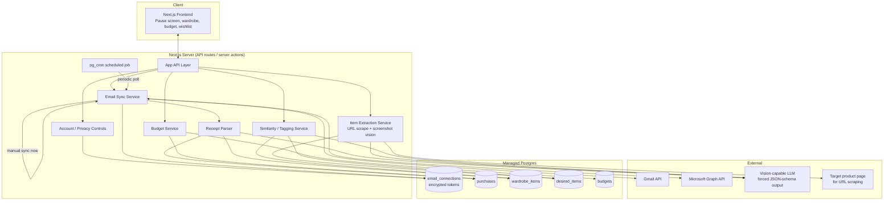
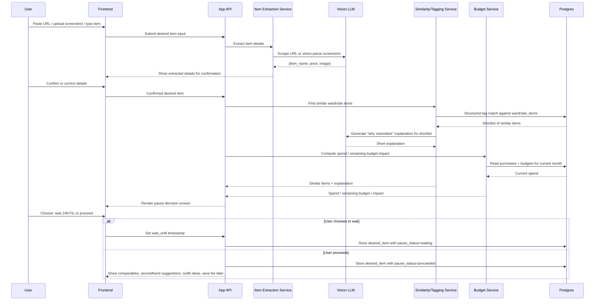
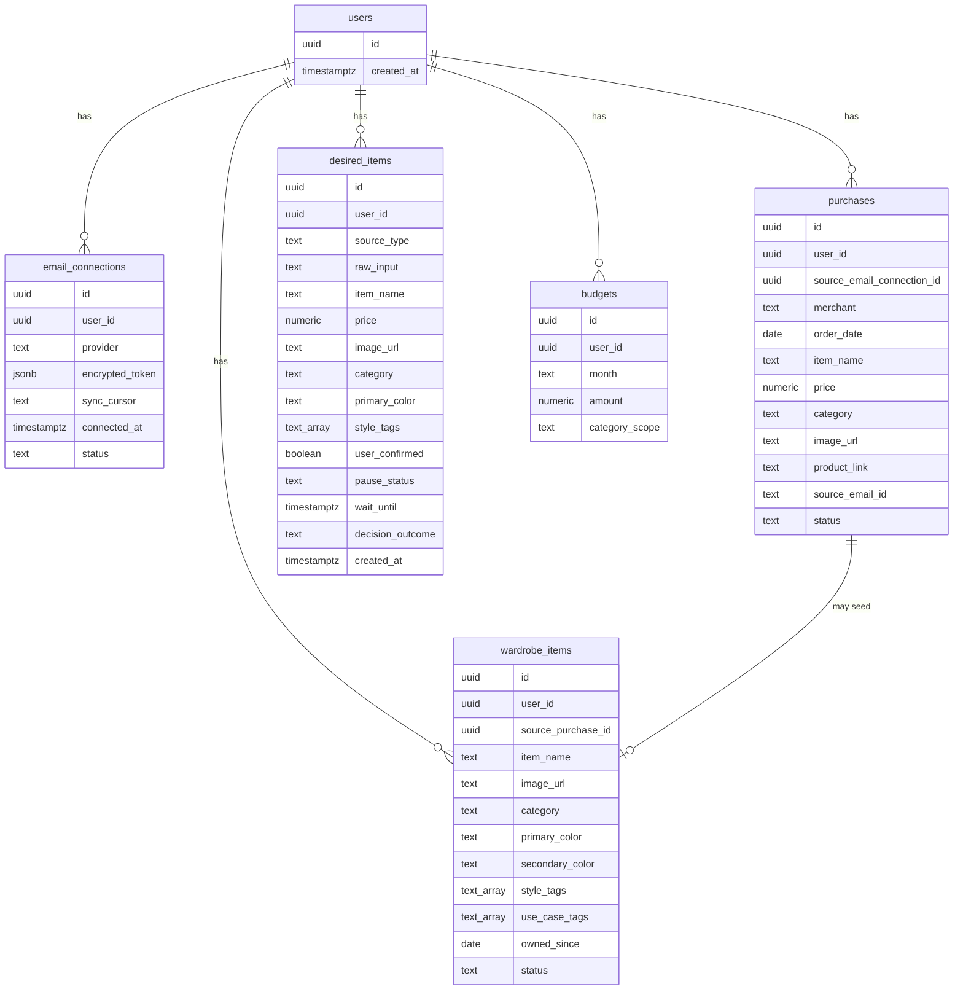

# Pause Before Purchase — Detailed Design

## 1. Overview

Pause Before Purchase is a privacy-first, single-user web app that helps its user avoid impulse shopping on clothing, shoes, and accessories. It builds a picture of what the user already owns — first by parsing order-confirmation emails from their connected Gmail/Outlook account, then letting them freely curate that into a wardrobe list — and uses that picture at the moment of temptation. When the user is considering a new purchase (pasting a product URL, uploading a screenshot, or typing an item description), the app shows a calm, nonjudgmental "pause" screen: what they already own that's similar, why the new item might be redundant, how the purchase affects their monthly clothing budget, and an optional 24-hour or 7-day wait timer. If the user still wants the item after that reflection, the app offers AI-suggested lower-priced alternatives, secondhand options, outfit ideas built from the existing wardrobe, and a "save for later" wishlist.

The core value proposition is *reflection, not restriction* — the app never blocks a purchase, it only slows down the decision and gives the user better information (what they already own, what it costs them, what alternatives exist) at the exact moment they're about to act on impulse.

This is built today as a personal, single-user tool, but with a data model and architecture deliberately structured so that multi-user support could be added later without a rewrite — while explicitly not building any multi-user features (signup, account management, data isolation UI) now.

## 2. Detailed Requirements

**Scope:** The entire app — purchase parsing, wardrobe, pause screen, budget, outfit ideas — is scoped to **clothing, shoes, and accessories only**. Other purchase categories (electronics, home goods, groceries, etc.) are not tracked or displayed anywhere in the product.

**Users and accounts:** Single-user personal tool for now. The user's identity is simply "whoever has successfully completed Gmail/Outlook OAuth" — there is no separate signup/password system. No multi-user features (account management UI, invites, roles, per-tenant enforcement) are built now, but every table in the data model carries a `user_id` from day one so a second real user is a row insert later, not a migration.

**Purchase history ingestion (email receipt parsing):**
- Primary transaction source is email receipt parsing via Gmail and Outlook OAuth — not a Shopify/merchant integration, since no single merchant platform covers a consumer's actual purchase history.
- On first connecting an account, the app **backfills the last 6 months** of email history to build initial purchase history and seed the wardrobe.
- After backfill, **ongoing sync runs both automatically on a periodic schedule and on-demand via a manual "sync now" button** — the user never has to choose one or the other.
- The app extracts merchant, order date, item name, price, category, and product image/link from order-confirmation emails.
- Because no API can natively filter "is this a fashion order confirmation," classification into clothing/shoes/accessories vs. everything else uses a **hybrid approach**: a rule-based pre-filter (known fashion-retailer sender domains and subject-line keywords) confidently classifies the common case without any AI call; only genuinely ambiguous emails are routed to an LLM classification step. This was explicitly chosen over pure LLM classification to reduce misclassification risk for the majority of receipts.
- The user can always correct or add items manually — auto-classification is a default, never the only path.

**Wardrobe:** The wardrobe is a **separate, freely editable list**, not simply "all parsed purchases":
- It is seeded automatically from parsed purchase history (minimizing manual data entry), but the user can add, edit, or remove items freely, including items never bought online (gifts, hand-me-downs, in-store cash purchases).
- Items can be marked **returned / no-longer-owned**, which removes them from the active wardrobe without deleting the underlying purchase record.

**Similarity matching (the "you already own something like this" logic):** Hybrid, in two stages:
1. Every item (wardrobe and newly-desired) gets structured tags — category, primary/secondary color, style tags, use-case tags — extracted once at ingestion time and cached.
2. Fast, cheap tag-based matching filters the full wardrobe down to a short list of genuinely similar candidates. Only that shortlist gets an AI pass, which generates a short, calm, specific "why this may be redundant" explanation referencing the actual overlapping attributes (e.g. color, style, purchase recency). This keeps AI cost and latency bounded regardless of total wardrobe size, and avoids full-catalog AI comparison on every check.

**Budget:**
- The user manually sets their own monthly clothing/shoes/accessories budget. The app may suggest a starting number based on historical spending, but the number itself is always user-set, never silently auto-adjusted.
- "Shopping spend" scope is clothing, shoes, accessories, and other discretionary fashion purchases only — explicitly **excluding** groceries, bills, subscriptions, and gifts bought for other people. This scoping happens at the same classification step used for wardrobe ingestion.
- The pause screen always shows current monthly spend, remaining budget, and exactly how the item under consideration would change both.

**The "I want to buy this" flow:**
- Input methods: paste a product URL, upload a screenshot, or type a free-text item description.
- For a pasted URL, the app **auto-extracts** item name/price/image by fetching the page server-side and scraping product metadata.
- For a screenshot, the app **auto-extracts** the same fields via a vision-capable LLM.
- In both cases, extracted details are always **shown to the user for confirmation or correction before proceeding** — auto-extraction is a convenience, never a silent, unverified input to the rest of the flow.

**The pause decision screen** shows, together:
- Similar items the user already owns, with images and purchase dates.
- A short AI-generated explanation of why the new item may be redundant (same color, style, category, or use case).
- Current monthly shopping spend, remaining budget, and the effect of this purchase on both.
- A 24-hour or 7-day wait option. Choosing to wait puts the item in an **in-app-only** waiting queue — there is no email or push notification. When the user next opens the app, a "waiting" queue/badge surfaces any item whose timer has elapsed, prompting a decision.

**If the user still wants the item after reflecting (or opts not to wait):**
- Lower-priced comparable items and secondhand/resale suggestions are **AI-generated best guesses for MVP** — no live web/shopping search integration, no external requests with the desired item's details. This trades guaranteed accuracy/live pricing for privacy and simplicity; live search is an explicit, clearly-labeled future upgrade once the core pause/reflect flow is validated.
- Outfit ideas are **text suggestions that reference the user's existing wardrobe photos** (e.g. "pair this with your navy blazer and the black boots you bought in March") — not a generated composite outfit image. Composite visual outfit rendering is an explicit future upgrade, not MVP scope.
- A "save for later" wishlist lets the user park the item without deciding immediately.

**Hosting and architecture:** A hosted cloud service (not a local-only or self-hosted app) — reachable from any device without the user managing a server. The architecture is kept simple, but structured so multi-user support is a future addition, not a rewrite.

**Privacy and security (non-negotiable, cross-cutting requirements):**
- Authenticated access only.
- Data encrypted both in transit and at rest.
- No sale or sharing of user data with third parties.
- Minimum necessary OAuth scopes are requested — read-only email access, nothing broader.
- Explicit user consent is required before the app imports any receipts, stating plainly what is read and what is never done (no send/delete/modify email access, no data sharing).
- "Disconnect" (stop syncing, keep already-parsed data) and "permanently delete" (revoke access and purge all derived data) are two distinct, clearly labeled controls — never one ambiguous button.

**Known accepted limitation:** Google's OAuth app stays in **testing mode** for now rather than pursuing full app verification, since the app has a single user today. This means Gmail tokens expire every 7 days (requiring re-authentication) and the user will see an "unverified app" warning on the Google consent screen. This is an accepted tradeoff to revisit only if/when the app is opened up to other users.

## 3. Architecture Overview

### Core end-to-end flow: "I want to buy this"

## 4. Components and Interfaces

**Email Sync Service**
- Responsibility: manage OAuth-connected Gmail/Outlook accounts; run the 6-month initial backfill on connect; run ongoing sync both on a scheduled interval (via `pg_cron`) and on-demand ("sync now").
- Inputs: stored, decrypted OAuth tokens; last-synced cursor (Gmail `historyId` / Graph delta token).
- Outputs: a stream of candidate order-confirmation emails handed to the Receipt Parser; an updated sync cursor persisted after each run.
- Talks to: `email_connections` table for tokens/cursor; Gmail API / Microsoft Graph directly; hands off to Receipt Parser for each candidate message.

**Receipt Parser**
- Responsibility: classify each candidate email as an in-scope (clothing/shoes/accessories) order confirmation or not, then extract merchant/date/item name/price/category/image/link from in-scope emails.
- Classification: rule-based sender-domain/keyword pre-filter first; only emails that pre-filter can't confidently classify go through an LLM classification pass on subject/sender/snippet.
- Extraction: cleaned email HTML run through an LLM structured-extraction pass (forced JSON schema); product images pulled directly from `` tags in the email body rather than via vision parsing.
- Outputs: new rows in `purchases`; triggers Wardrobe Service to seed a corresponding `wardrobe_items` entry.
- Talks to: Vision/LLM for classification and extraction; `purchases` and `wardrobe_items` tables.

**Item Extraction Service**
- Responsibility: turn a pasted URL, uploaded screenshot, or typed description into a structured desired-item record, always pausing for user confirmation before the item proceeds into the pause-decision flow.
- URL path: server-side fetch of the page, scrape title/price/image metadata.
- Screenshot path: vision-LLM call with a forced schema (`item_name`, `price`, `currency`, `image_description`), instructed to isolate the single main product and prefer current/sale price over a struck-through original price.
- Typed-text path: no extraction needed, used directly (still shown for confirmation for consistency).
- Outputs: a `desired_items` row in `extracted` state, pending user confirmation.
- Talks to: target web page (URL path only); Vision LLM (screenshot path only); `desired_items` table.

**Wardrobe Service**
- Responsibility: CRUD for wardrobe items; seeding new items automatically from parsed purchases; marking items returned/no-longer-owned; supporting manually-added, non-purchased items.
- Outputs: current active wardrobe (used by Similarity/Tagging Service) and full wardrobe history (including returned items, for record-keeping only).
- Talks to: `wardrobe_items` table; triggered by Receipt Parser (auto-seed) and directly by the user (manual add/edit/remove/mark-returned).

**Similarity/Tagging Service**
- Responsibility: extract and cache structured tags (category, color, style/use-case) for every item once at ingestion time; on a pause-decision request, tag-match the desired item against the active wardrobe to produce a shortlist, then generate the "why this may be redundant" explanation for that shortlist only.
- Talks to: Vision LLM (tag extraction at ingestion; explanation generation on the shortlist only); `wardrobe_items` and `desired_items` tables for tag storage.

**Budget Service**
- Responsibility: hold the user's manually-set monthly clothing/shoes/accessories budget; suggest a starting figure from historical spend (suggestion only, never auto-applied); compute current-month spend and remaining budget, scoped to in-scope categories only.
- Talks to: `budgets` table; `purchases` table (spend calculation, excluding categories outside scope).

**Pause Decision Screen** (frontend + a supporting API endpoint that assembles the payload)
- Responsibility: render, in one view, the confirmed desired item, the similar-items shortlist with images/dates, the redundancy explanation, the budget impact, and the 24h/7-day wait controls.
- Talks to: Similarity/Tagging Service and Budget Service (via the API layer) to assemble its data; Wait/Reminder Queue to record a wait decision.

**Wait/Reminder Queue**
- Responsibility: track desired items the user chose to wait on, with a `wait_until` timestamp; surface an in-app "waiting" queue/badge for items whose timer has elapsed. No email or push notifications are sent.
- Talks to: `desired_items` table (`pause_status`, `wait_until` fields); frontend polls/reads this on app load to render the badge.

**Post-Wait Recommendations**
- Responsibility: once the user indicates they still want the item (immediately, or after waiting), generate AI best-guess lower-priced comparables and secondhand/resale suggestions (no live search), generate outfit-idea text suggestions referencing existing wardrobe photos, and offer "save for later."
- Talks to: Vision/LLM (best-guess comparables, secondhand suggestions, outfit-idea text generation); `wardrobe_items` (source photos for outfit ideas); `desired_items` (save-for-later state).

**Account / Privacy Controls**
- Responsibility: OAuth connect flow (with an explicit consent screen before first import), "disconnect" (revoke token + stop sync, keep parsed data), and "permanently delete" (revoke token + purge all data derived from that connection).
- Talks to: `email_connections` table; Gmail/Microsoft token-revocation endpoints; cascades delete across `purchases`/`wardrobe_items` rows sourced from the deleted connection on permanent delete.

## 5. Data Models

**Notes on fields:**
- `users.id` is the anchor for multi-tenant readiness — every other table carries `user_id`, filtered by the authenticated session, never a client-supplied value.
- `email_connections.encrypted_token` stores a `{iv, tag, ciphertext}` envelope, encrypted with AES-256-GCM using an application-level key managed via a cloud KMS — on top of the managed Postgres provider's disk-level encryption.
- `purchases.status` is `active` or `returned`; a return doesn't delete the purchase record, it just excludes it from budget calculations and from auto-appearing as an active wardrobe item.
- `wardrobe_items.source_purchase_id` is nullable — items seeded from a purchase have it set; manually-added items (gifts, hand-me-downs) don't. `wardrobe_items.status` is `active` or `returned`/`removed`.
- `desired_items.source_type` is `url`, `screenshot`, or `typed`. `pause_status` is `pending_confirmation`, `waiting`, `proceeded`, or `saved_for_later`. `decision_outcome` (nullable until decided) records what the user ultimately did, for the user's own reflection/history, not for any external reporting.
- `budgets.category_scope` is fixed to the clothing/shoes/accessories scope for MVP but stored as a field (not hardcoded) so scope could vary later without a schema change.

## 6. Error Handling

- **Email parsing yields no confident merchant/price extraction:** the email is stored as a low-confidence draft purchase (or skipped entirely if it doesn't even pass the classification pre-filter) rather than silently discarded; low-confidence extractions surface in a review queue where the user can confirm, correct, or discard them, consistent with "let users correct or add items manually."
- **URL scraping fails or is blocked** (e.g. site blocks server-side fetches, page requires login): the Item Extraction Service falls back to manual entry for that item — the user is told extraction failed and asked to fill in name/price/image themselves; the raw URL is still stored as a reference link.
- **Screenshot vision-parsing can't identify a product:** same fallback — show the screenshot back to the user with empty/best-guess fields and ask them to fill in or correct what the model couldn't determine, rather than blocking the flow.
- **OAuth token expired or revoked** (including the accepted 7-day testing-mode expiry): the Email Sync Service marks the connection's `status` as `expired`, stops scheduled sync attempts for that connection, and the frontend shows a clear "reconnect your email" prompt rather than failing silently or retrying indefinitely.
- **AI classification is ambiguous even after LLM fallback:** the email is held in the review queue with a "not sure — please confirm" state rather than being force-classified either way; it never silently counts toward the budget or wardrobe until the user confirms it.
- **Budget data missing for a new user with no history yet:** the Budget Service shows a clear "set your first budget" prompt instead of a suggested figure, and the pause screen simply omits the budget-impact section (rather than showing a misleading $0 or error) until a budget is set.

## 7. Testing Strategy

- **Email parsing/classification pipeline:** maintain a fixtures directory of real-shaped (but synthetic/anonymized) sample order-confirmation emails covering the major retailer HTML patterns actually seen (a handful of common fast-fashion, department-store, and boutique templates), plus a set of clearly out-of-scope emails (electronics, grocery, subscription receipts) to verify the rule-based pre-filter correctly excludes them without ever reaching the LLM. Test the LLM classification fallback path separately against a smaller set of deliberately ambiguous fixtures (e.g. a department store email that sells both clothing and home goods) to confirm it lands in the review queue rather than being force-classified.
- **AI tagging, similarity, and redundancy-explanation logic:** because outputs are AI-generated text/tags, use golden-example-based evals rather than exact-match assertions — a fixed set of (item, wardrobe) pairs with a human-approved "acceptable output" range (e.g. tag extraction must include the correct `category` and `primary_color` even if exact style-tag wording varies; the redundancy explanation must reference at least one of the actual overlapping attributes). Run these as a scored eval suite, not pass/fail unit tests, and track score trends across model/prompt changes.
- **Pause decision screen (UI):** standard component tests for rendering given a mocked API payload (similar items, explanation, budget impact, wait controls), plus integration tests covering the full "confirm item → see pause screen → choose wait vs. proceed" flow against a seeded test database, asserting the correct `pause_status`/`wait_until` state is persisted for each path.
- **OAuth/privacy flows:** integration tests for connect (mocked OAuth provider, verifying token is stored encrypted, never in plaintext, in the test database), disconnect (verifying token revocation is called and sync stops, while `purchases`/`wardrobe_items` rows remain), and permanent delete (verifying token revocation is called *and* all rows derived from that connection are actually removed — this test should assert on row counts before/after, not just a success response, since silent partial deletion would violate the privacy requirement).

## 8. Appendices

### 8.1 Technology Choices

| Choice | Why | Tradeoff accepted |
|---|---|---|
| **Next.js** (full-stack, UI + API routes/server actions) | One framework for both frontend and the backend logic needed for email sync, OAuth token exchange, and AI extraction calls; minimizes new infrastructure for a single-user MVP. | Less separation of concerns than a dedicated backend service; acceptable at this scale, revisit if the app grows significantly. |
| **Managed Postgres** (e.g. Neon/Supabase/RDS) | Encryption at rest, backups, and connection pooling with no operational burden; all major providers support `pg_cron`. | Less control than self-hosting; accepted in exchange for far less operational work, consistent with the "hosted cloud service" decision. |
| **`pg_cron` for periodic sync** | Runs inside Postgres itself; no separate job-queue service needed for a single periodic poll + on-demand trigger. | Would need to move to a real job queue (e.g. `pg-boss`) if multi-user concurrency later demands retry/backoff semantics — explicitly deferred, not needed now. |
| **App-level KMS + AES-256-GCM envelope encryption for OAuth tokens**, on top of provider disk encryption | Tokens are the single most sensitive data in the system (a leaked token grants ongoing email read access); disk encryption alone treats them the same as any other row, which understates their sensitivity. | Adds a KMS dependency and decrypt-on-read complexity versus relying solely on provider disk encryption — accepted given the privacy-first requirement. |
| **Vision-capable LLM with forced JSON-schema output** for tag extraction, screenshot parsing, redundancy explanations, and outfit-idea text | One consistent technique covers all four AI-dependent features; forced schema avoids brittle free-text parsing. | Ongoing per-call cost/latency versus a rule-based or fine-tuned approach — accepted since call volume is naturally bounded (cached at ingestion; only triggered on actual purchase consideration). |

### 8.2 Research Findings Summary

- Gmail API (`historyId` incremental sync) and Microsoft Graph (delta queries) are both strictly better than IMAP for this use case — structured querying and a real incremental-sync cursor, rather than manual raw-MIME handling (see `research/email-receipt-parsing.md`).
- Neither email API can filter "is this a fashion order confirmation" natively; enforcing the clothing/shoes/accessories scope is a classification step (rule-based pre-filter + LLM fallback), not something the API does for you (see `research/email-receipt-parsing.md`).
- Product images embed as `` tags in most retailer confirmation emails and can be extracted directly from HTML — no vision parsing needed for that specific step (see `research/email-receipt-parsing.md`).
- Gmail requires the full `gmail.readonly` scope (body access) since `gmail.metadata` can't see item/price content; Outlook needs only `Mail.Read`, never the shared-mailbox variant (see `research/oauth-scopes-and-privacy.md`).
- Google's OAuth "testing mode" is viable and appropriate at single-user scale but carries a 7-day token expiry and an unverified-app warning screen — an accepted, explicitly scoped limitation, not an oversight (see `research/oauth-scopes-and-privacy.md`).
- "Disconnect" and "permanently delete" should be built as two distinct, clearly labeled controls, and permanent delete should behave like a prompt, complete right-to-erasure request across live data (see `research/oauth-scopes-and-privacy.md`).
- One consistent technique — vision LLM plus forced structured output — covers structured tag extraction, screenshot parsing, and redundancy-explanation generation; tag extraction should run once at ingestion and be cached, not recomputed per comparison (see `research/ai-tagging-and-vision.md`).
- Outfit-idea generation is scoped to text suggestions referencing existing wardrobe photos for MVP; actual composite outfit image generation is a materially harder, separate problem and is explicitly out of MVP scope (see `research/ai-tagging-and-vision.md`).
- Next.js + managed Postgres is the "boring, well-supported" default stack appropriate for this scale, with `pg_cron` covering the scheduled-sync requirement without standing up a separate job queue (see `research/hosting-and-backend-stack.md`).
- The entire cost of "multi-tenant readiness" without building multi-user features is putting `user_id` on every table from the first migration and always filtering by session `user_id` — no Row-Level Security or signup UI is needed yet (see `research/multi-tenant-readiness.md`).
- Existing wardrobe apps (Whering, Indyx) validate the "auto-populate, always allow correction" pattern for cataloging, and Rocket Money validates the same pattern for transaction categorization; no existing consumer app uses email-receipt parsing as its primary transaction source, so this project's ingestion pipeline is a genuinely novel piece, not one with directly transferable prior art (see `research/prior-art.md`).

### 8.3 Alternative Approaches Considered

| Decision | Alternative considered | Why the chosen option won |
|---|---|---|
| Gmail API / Microsoft Graph for email access | Raw IMAP | IMAP has no equivalent to `historyId`/delta-query incremental sync, forcing far more manual, error-prone sync-state tracking; the APIs also support server-side query filtering IMAP lacks. |
| Hosted cloud service | Local-only (browser-only, IndexedDB) | OAuth email access and server-side URL scraping/vision-model calls are difficult or impossible fully client-side; local-only was ruled out early in requirements clarification (idea-honing Q8). |
| Hosted cloud service | Self-hosted single-user server | Full data control, but the user would be responsible for running/updating their own server; a managed hosted service was chosen for simplicity and reachability from any device, accepting the privacy-first controls (encryption, minimal scopes, delete controls) as the mitigation instead of self-hosting. |
| AI best-guess for comparables/secondhand | Live web/shopping search (eBay, Poshmark, ThredUp, Google Shopping APIs) | Live search gives real, current listings but requires sending the desired item's description to third-party services at request time; MVP prioritizes not making any external request with user purchase-intent data, deferring live search to an explicitly labeled future upgrade once the core flow is validated. |
| Outfit ideas as text suggestions referencing existing photos | Generated composite outfit image (flat-lay mockup) | Composite image generation/compositing is a materially harder, separate technical problem than the text/reasoning task of naming compatible existing items; scoped out of MVP as a future upgrade. |
| Hybrid rule-based pre-filter + LLM fallback for email classification | Pure LLM classification for every email | Pure LLM classification was the initial research recommendation but was explicitly rejected by the user as insufficiently reliable; the hybrid approach reduces LLM-driven misclassification risk for the common case (known retailers) while still handling the long tail via LLM fallback. |
| Structured tags + shortlist AI explanation (hybrid similarity) | Full AI-based comparison across the entire wardrobe for every check | Full AI comparison doesn't scale cost/latency-wise with wardrobe size; the hybrid approach bounds AI calls to a pre-filtered shortlist regardless of how large the wardrobe grows. |

### 8.4 Key Constraints and Limitations

- **Google OAuth testing-mode limitations:** Gmail tokens expire every 7 days, requiring the user to re-authenticate weekly, and the user sees an "unverified app" warning screen on Google's consent page. This is an accepted tradeoff for a single-user app avoiding full app verification; it should be revisited only if the app is ever opened up to other users.
- **AI classification and tagging will occasionally be wrong.** The hybrid rule-based/LLM approach reduces but does not eliminate misclassification; the manual-correction path (review queue, editable wardrobe, editable budget category scope) is a required part of the product, not a nice-to-have.
- **AI-generated comparables and secondhand suggestions are not guaranteed to be accurate, current, or real.** They are explicitly best-guess suggestions with no live data behind them at MVP; the UI must communicate this honestly (e.g. "suggestions, not verified listings") rather than presenting them as real search results.
- **No structured markup (schema.org `Order`) can be relied upon** in real-world retailer confirmation emails — the extraction pipeline must work from unstructured/semi-structured HTML via LLM extraction as its primary path, treating any structured markup as a bonus when present, not a dependency.
