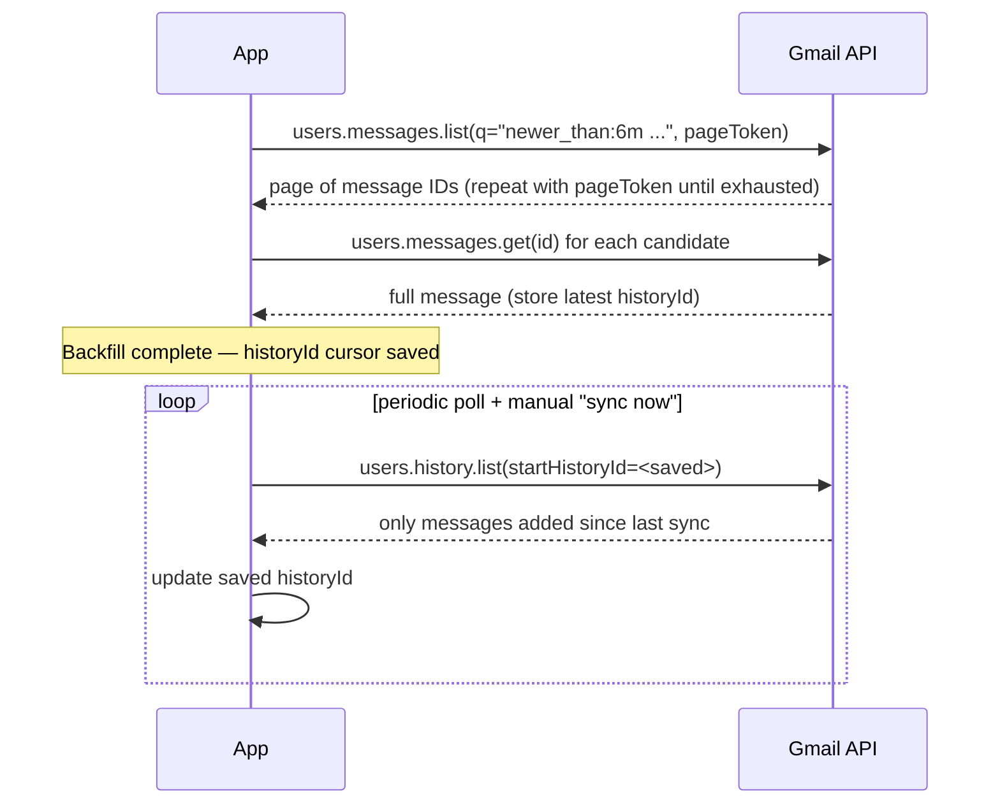

# Email Receipt Parsing: Gmail API vs IMAP, Outlook Graph API

## API choice

**Gmail:** Use the Gmail REST API, not raw IMAP. The API gives structured message metadata (headers, labels, `historyId`) and supports the `q` search parameter for server-side filtering, whereas IMAP only gives you raw folder/message access and forces all filtering client-side. IMAP also has no equivalent of Gmail's `historyId` incremental-sync cursor (see below), so keeping in sync after the initial backfill is much more manual.

**Outlook:** Use Microsoft Graph (`/me/messages`), which is the modern replacement for both EWS and IMAP for Microsoft 365/Outlook.com mailboxes. Graph supports `$search`/`$filter` for query-side filtering and delta queries (`/me/mailFolders/inbox/messages/delta`) as its equivalent of Gmail's `historyId` cursor. [Show a user's emails — Microsoft Learn](https://learn.microsoft.com/en-us/training/modules/msgraph-dotnet-core-show-user-emails/5-show-users-email)

## Filtering to fashion/clothing/shoe/accessory order confirmations specifically

Neither API can filter by "is this a fashion order confirmation" natively — that requires a layered approach:
1. **Server-side coarse filter:** Gmail `q` search (e.g. `subject:(order OR shipped OR confirmation) newer_than:6m`) or Graph `$search` to cut the fetch volume before doing any heavier work.
2. **Sender/domain allowlist + heuristics:** match against a known set of fashion/retail sender domains (built up over time from what the user actually gets) plus generic order-confirmation subject patterns.
3. **LLM classification pass:** feed the (still cheap, header-only) subject + sender + snippet to an LLM to classify "is this a fashion/clothing/shoe/accessory order confirmation, y/n" before doing the expensive full-body extraction. This step is where the "clothing/shoes/accessories only" scope decision actually gets enforced — it's a classification step, not an API filter.

Rule-based parsers (used by tools like Mailparser/Parseur) work well when you control the format, but are brittle against dozens of different retailer email templates. Layout-agnostic AI extraction reads the email similarly to how a person would and is more robust to template variation, at the cost of per-email LLM calls. [Best Email Parser in 2026](https://airparser.com/blog/best-email-parser/), [Parse email data using AI — MailSlurp](https://www.mailslurp.com/blog/extract-structured-data-from-emails/)

## Extracting merchant/date/item/price/category/image

Order-confirmation emails vary widely in structure; realistically:
- **Structured markup (schema.org `Order`/`ItemList`) is rare** in consumer retail confirmation emails in practice — don't rely on it as a primary path, treat it as a bonus when present.
- **Primary approach:** convert the email HTML to a cleaned-up text/markdown representation, then run an LLM extraction pass with a forced structured-output schema (merchant, order date, item name, unit price, product image URL, product link) — the same "tool use with JSON schema" pattern that works for vision extraction (see `ai-tagging-and-vision.md`).
- **Images:** most retailer confirmation emails embed product thumbnails as `` tags with absolute URLs — extract those directly from HTML rather than needing vision parsing for this step.
- IMAP forces you to do all of the above after pulling full raw MIME yourself; both Gmail API and Graph give you HTML body content directly via a `messages.get`/`GET /messages/{id}` call, which is simpler.

## Backfill vs incremental sync

- **Backfill (6 months):** `users.messages.list` with a date-bounded query, paginating through `nextPageToken` until exhausted; store the mailbox's current `historyId` once backfill finishes as the sync cursor.
- **Ongoing sync:** `users.history.list(startHistoryId=...)` returns only what changed since that cursor — far cheaper than re-listing everything. Gmail also supports push notifications via Cloud Pub/Sub (`users.watch`) as an alternative to polling, but push has a per-user rate limit (1 event/sec) and can silently drop notifications, so apps still need a periodic `history.list` fallback poll regardless. [Configure push notifications — Gmail API](https://developers.google.com/workspace/gmail/api/guides/push), [Gmail API Push Notifications Guide](https://www.unipile.com/gmail-api-push-notifications/)
- **Outlook equivalent:** initial backfill via `$filter=receivedDateTime ge <6-months-ago>` with paging, then delta queries (`/messages/delta`) as the ongoing-sync cursor, same shape as Gmail's `historyId`.
- Given the decision to do **both automatic periodic poll and manual "sync now"**, plain polling via `history.list`/`delta` on a schedule (e.g. every few hours) plus an on-demand endpoint that runs the same poll immediately is simpler to build and reason about than standing up Pub/Sub push infrastructure — push can be a later optimization, not a v1 requirement.

## Key takeaways for design
- Use Gmail API + Microsoft Graph, not IMAP, for both easier querying and a real incremental-sync cursor (`historyId` / delta token).
- Enforce the "clothing/shoes/accessories only" scope via an LLM classification step on subject/sender/snippet, not via API-level filtering — the APIs can't do domain-specific classification.
- Extraction of merchant/date/item/price uses an LLM structured-extraction pass over cleaned email HTML; product images are pulled directly from `` tags rather than needing vision parsing.
- The chosen sync model (6-month backfill + automatic poll + manual sync button) maps directly onto `history.list`/delta-query polling — no need for Pub/Sub push infrastructure at MVP scope.
