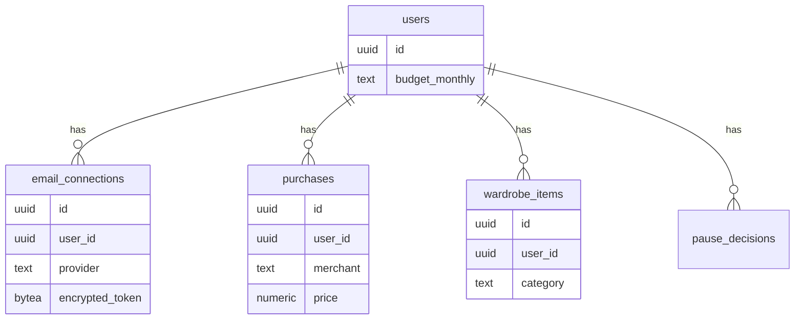

# Multi-Tenant Readiness Without Building Multi-User Now

## Core pattern: shared schema + `user_id` from day one

The standard, lowest-cost way to keep a single-user app extensible to multi-user later is the same pattern most SaaS products start with anyway: **one database, one set of tables, with a `user_id` (or `tenant_id`) column on every table from the very first migration** — even though today there's exactly one row in the `users` table. Adding a second real user later becomes a row insert, not a schema migration or data migration. [The developer's guide to SaaS multi-tenant architecture — WorkOS](https://workos.com/blog/developers-guide-saas-multi-tenant-architecture), [Building a Multi-Tenant SaaS: The Database Design Nobody Talks About](https://navanathjadhav.medium.com/building-a-multi-tenant-saas-the-database-design-nobody-talks-about-7831b576655f)

## What "ready, not built" actually means here

- **Do:** put `user_id` on every table now, always filter every query by the authenticated session's `user_id` (never a client-supplied value), and avoid any global singleton state (e.g. no module-level "the current user's budget" cached outside a per-request/per-user context). [Multi-Tenant Database Architecture Patterns Explained](https://www.bytebase.com/blog/multi-tenant-database-architecture-patterns-explained/)
- **Don't (yet):** build signup/login UI beyond the single OAuth-based session already needed for Gmail/Outlook connection, build any per-tenant data isolation *enforcement* like Postgres Row-Level Security policies, or build account-management screens (invite, roles, billing). Those are the actual "multi-user feature" work explicitly deferred in idea-honing.
- **Auth for the single user today:** the app's own session can just be "whoever successfully completed Gmail/Outlook OAuth" — there's no separate signup/password system needed since the email OAuth connection *is* the identity for a personal tool. When multi-user support is eventually added, this becomes the pattern for every user's session, not something to redo.

## Token storage isolation

Store OAuth tokens in their own table (`email_connections`) keyed by `user_id`, rather than as loose columns on the `users` table — this is what makes "disconnect this specific email connection" (from the privacy/consent requirements) a clean row-delete rather than a column-null-out, and it's also what naturally supports a user having *both* Gmail and Outlook connected simultaneously without a schema change.

## Key takeaways for design
- Every table gets `user_id` starting with the very first migration, even with one user row — this is the entire "multi-tenant readiness" cost, and it's near-zero to pay now versus expensive to retrofit later.
- No Row-Level Security, signup flow, or account-management UI needed yet — those are the real "multi-user feature" work, correctly deferred per idea-honing.
- Keep OAuth connections in their own `user_id`-keyed table, not flattened onto the user row, so the "disconnect + delete" flows from the privacy requirements map to simple row operations.
